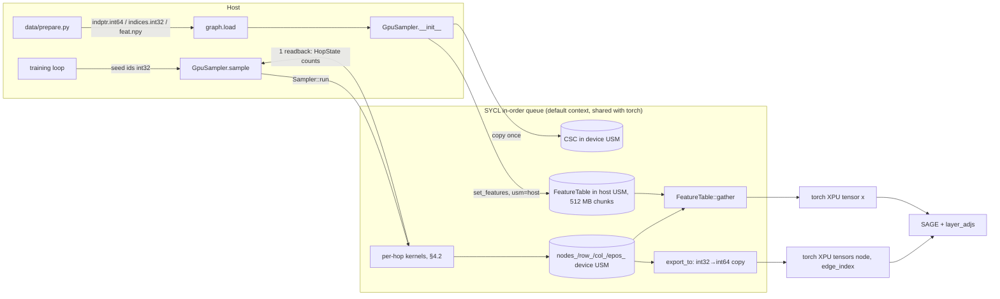
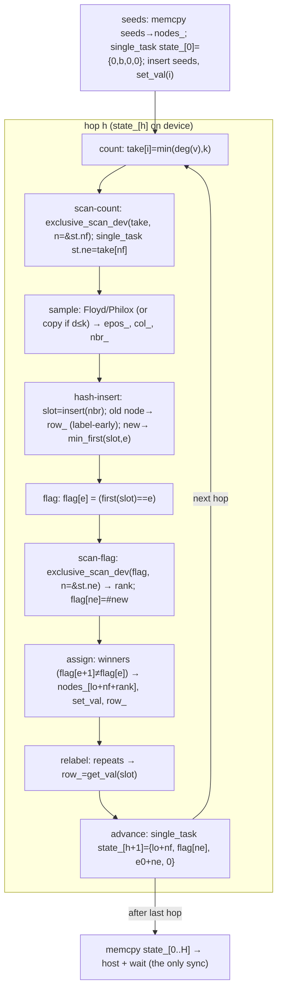

# gnnsample architecture

This document explains how gnnsample is built, what each part does, how data moves
through it, and how to change it without breaking anything. It is written for a new
contributor or an AI coding agent. Every number below comes from
[`docs/decisions.md`](decisions.md) (records D1 to D18) or from a file under `results/`. The
reasoning behind each design choice, and the alternatives that were rejected, are in
`decisions.md`. This document explains the mechanics and links to those records.

---

## 1. Purpose and scope

gnnsample is a **SYCL/DPC++ GPU neighbour sampler for GraphSAGE-style minibatch GNN
training** on large graphs, together with a GPU feature gather. It is a drop-in
replacement for the data-preparation half of PyG's `NeighborLoader`. It was developed and
measured on an Intel Core Ultra 7 265U laptop iGPU, inside Docker on WSL2, and compared
with PyG 2.8.1 + pyg-lib 0.9.0.

- **Workload (fixed, D1):** fanout `[15, 10, 5]`, 3 layers, sampling without
  replacement, batch 1024. The kernels read fanouts at run time; each must be in `[1, 64]`.
- **Semantics (D10):** PyG `NeighborSampler` with `disjoint=False, replace=False`. Each
  hop expands only the nodes that were first discovered at the previous hop.
- **What "correct" means:** the output is **bit-identical** to the NumPy reference
  [`python/gnnsample/reference.py`](../python/gnnsample/reference.py). That covers the
  same node list, the same local ids, the same edges in the same order, and the same
  per-hop counts, for every option combination and on every SYCL device. The reference is
  the source of truth. If the GPU and the reference disagree, the GPU code is wrong.
- **Status:** Phases 0 to 3 and the Phase 5 report ([`docs/report.html`](report.html)) are
  done. The headline results, all from `decisions.md`, are:
  - 6.4 to 7.9× faster per minibatch than pyg-lib.
  - A 1.35× faster mean end-to-end training step than PyG's best worker setting.
  - Accuracy parity on ogbn-products (test p = 0.90).
  - The NVIDIA/CUDA comparison (Phase 4b) has not been done yet.

## 2. Repository map

`gnnsample/` is a git repository (branch `main`). Datasets, caches and build output
are excluded by `.gitignore`.

| Path | Role |
|---|---|
| `CMakeLists.txt` | Builds the nanobind extension `_C` (written into `python/gnnsample/`) and two SYCL tools. Selects SPIR-V JIT or AOT device targets |
| `CLAUDE.md` | Agent quick-start: commands and rules |
| **`cpp/include/gnnsample/`** | Header-only SYCL core |
| `sampler.hpp` | `Sampler`: the multi-hop sampler. Contains the `run()` host-sync path, the `run_nosync()` / `run_nosync_t<SlotT, PhiloxReuse, View>` no-sync path, the `SamplerOption` bitmask, the dedup tables `HashView` / `GenHashView` / `DirectView`, `HopState`, and stage profiling |
| `scan.hpp` | `ScanWorkspace`: device-wide exclusive prefix sum. Host-sized variants (`basic`, `single_group`, `tiled`) and the device-sized `exclusive_scan_dev` |
| `philox.hpp` | Philox-4x32-10, `draw_u32(seed, hop, node, draw)` and the multiply-shift `bounded()`. Must match `philox.py` word for word |
| `multi.hpp` | `MultiSampler` (D22; batched mode is the primary design, D24): K minibatches per launch (`batched`) or one per work-group (`megakernel`); D23 adds `set_reorder`, `set_hubs` and the batched-mode locality schedule `set_schedule`; D25 adds `set_table` (per-minibatch dedup table: `direct` 8 B per graph node, `hash` = `GenHashView` with the smallest power-of-two ≥ `max_nodes` slots of 16 B, `auto` = fewer bytes; both kernels templated over the view; one shared generation, full reset on wrap) and memory accounting (`device_bytes`, `table_bytes`, `buffer_bytes`). The graph pointers are borrowed, so `_C.MultiSampler.from_sampler(sampler, ...)` can run on a `_C.Sampler`'s device graph |
| `hints.hpp` | `load_nbr`: neighbour read with an Intel LSC streaming cache hint for non-hub rows (D23 `kHubHints`) |
| `gather.hpp` | `FeatureTable`: a row-major float table in device, host or shared USM, split into chunks of at most 512 MB, plus a float4 gather kernel |
| `cpp/src/module.cpp` | nanobind bindings: `_C.Sampler`, `_C.Gather`, and the option constants (`_C.PACKED_HASH`, ...). Uses the platform default SYCL context, so the sampler can write into PyTorch XPU tensors |
| `cpp/tools/device_info.cpp` | Lists SYCL devices (sub-group sizes, local memory, largest single allocation, USM and int64 atomics support) and runs a smoke kernel |
| `cpp/tools/launch_overhead.cpp` | Measures kernel launch, host wait, an 8-byte readback and a 32 MB fill. This is the evidence for the no-sync design (D13) |
| **`python/gnnsample/`** | Python package (`PYTHONPATH=/work/python` in the container) |
| `reference.py` | NumPy reference sampler: **the semantics definition** |
| `philox.py` | Vectorised NumPy Philox, the reference for `philox.hpp` |
| `loader.py` | `DEFAULT_OPTIONS`, `GpuSampler` (sample + gather into XPU tensors), `PrefetchingGpuSampler` (double-buffered overlap, D16), `BatchedGpuSampler` (K minibatches per launch, per-minibatch gather, slot semaphores; XPU and CPU; D25: `share_graph_with=<GpuSampler>` reuses that sampler's device graph, `table=` picks the dedup table, `slots="grow"` sizes XPU slots to the first block's largest minibatch × 1.25 and regrows a slot only while the producer holds it, `slots="max"` keeps worst-case slots; `memory()` / `device_bytes()` report allocations) and `training_sampler()`, which picks `DEFAULT_SAMPLER = "batched"` (D24) or `"single"` |
| `neighbor_loader.py` | `gnnsample.NeighborLoader`: drop-in replacement for `torch_geometric.loader.NeighborLoader` on homogeneous graphs (§4.7). `sampler="batched"` (default, `K=8`) or `"single"`; custom options or fanouts above 16 fall back to single with a warning |
| `models.py` | GraphSAGE (`SAGE`) with layer trimming (`layer_adjs`), and `orient` (edge direction check) |
| `graph.py` | `load(name)`: reads `data/csc/<name>/` and refuses feature arrays that are not row-major. `name@method` loads a reordered copy, with the original graph's extras and `Graph.order` |
| `reorder.py` | D23 graph reordering: `compute_order` (degree / hubsort / rcm / random), `permute_csc`, `pos_shift`, `hub_count`; `python -m gnnsample.reorder` writes `data/csc/<g>@<method>/` |
| `synthetic.py` | `power_law_csc`: Chung-Lu power-law CSC graphs for tests (no download) |
| `_C.cpython-312-x86_64-linux-gnu.so` | Build output (ignored by `.gitignore`) |
| **`data/`** | |
| `prepare.py` | Downloads products, LiveJournal, Orkut or Friendster and writes the binary CSC (§3) |
| `prepare_small.sh` | Runs `prepare.py` for products, LiveJournal and Orkut |
| `csc/<name>/` | Prepared graphs: `indptr.int64.bin`, `indices.int32.bin`, `meta.json`, plus OGB extras `feat.npy`, `label.npy`, `{train,valid,test}_idx.npy` |
| `raw/` | Download cache |
| **`bench/`** | Benchmarks (§8.4 lists each one) |
| **`tests/`** | `test_reference.py` (RNG and reference invariants), `test_gpu_sampler.py` (GPU vs reference, every option, file loading), `test_pipeline.py` (export, gather, prefetch), `test_neighbor_loader.py` (drop-in loader vs the graph and PyG), `test_multi.py` (D22 modes; D25 hash vs direct tables across a generation wrap, shared graph), `test_reorder.py` (D23: reordered graphs, hints and schedule stay bit-identical) |
| **`examples/`** | `train_products.py`: a plain PyG training loop where switching to gnnsample is one import line |
| **`tools/`** | `run_logged.sh` (container run with a timeout, a log and the power state), `watch_runs.sh` (stall/done/low-memory watcher that exits by itself), `convert_twitter.sh` (WebGraph decode in the `gnnsample-webgraph` image), `d23_runs.sh` (D23 test and benchmark list) |
| `docker/webgraph/` | Converter image: OpenJDK + WebGraph 3.6.12 and `ToCsc.java`, which streams a transposed BVGraph into the CSC (D19) |
| `data/finish_twitter.py` | Validates the Twitter-2010 CSC and writes its `meta.json` (D19) |
| `docker/Dockerfile`, `docker/requirements.txt`, `docker-compose.yml` | The `gnnsample-dev` image and its runtime settings (§7) |
| **`docs/`** | `decisions.md` (D1 to D23, the why), `research.md` (literature, baselines, datasets), `report.html` (Phase 5 report), this file |
| **`results/`** | Measurements: `ablation.jsonl`, `sampler_stages.jsonl`, `overlap_ab.jsonl`, `train_e2e.jsonl`, `accuracy/*.json`, `profile_pyg_*.json`, `gather_products.json`, `sampling_products.json`, and `logs/*.log` (one per `run_logged.sh` run). **Never edit these by hand.** |
| `.gpu_cache/` | Persistent SYCL and NEO kernel JIT cache (§7.4) |
| `build/` | CMake/Ninja build tree (configured with `icpx`, `spir64`) |

## 3. Data model

### 3.1 Graph on disk and on the device (CSC, D3)

`data/prepare.py` writes one format, and every sampler (ours, pyg-lib, and DGL if added)
reads exactly that format:

- `indptr.int64.bin` holds `n+1` offsets, and `indices.int32.bin` holds neighbour ids. The
  **in**-neighbours of `v` are `indices[indptr[v]:indptr[v+1]]`.
- int64 offsets leave room for graphs with more than 2³¹ edges. int32 node ids halve the
  bytes moved per sampled edge, and every target graph has fewer than 2³¹ nodes.
- Node ids are compacted to `0..n-1`. Undirected graphs are symmetrised, so both
  directions are stored. Directed graphs store in-edges (`u→v` is stored under `v`). Self
  loops and duplicate edges are removed.
- Neighbours of each node are sorted by id, because `build_csc` sorts the `dst*n + src`
  keys. Sampled edge positions are global CSC positions, so this order is part of the
  output.
- OGB features are saved **row-major** (`np.ascontiguousarray`). A column-major table once
  made the CPU gather 15× slower (D9 measurement 3), so `graph.load` raises an error on
  any extra array that is not C-contiguous.
- Twitter-2010 is not produced by `prepare.py`. `tools/convert_twitter.sh` decodes the
  publisher's transposed WebGraph file with `docker/webgraph/ToCsc.java` straight into the
  same two files, and `data/finish_twitter.py` validates them and writes `meta.json` (D19).
- **Two ways onto the device.** `_C.Sampler(indptr, indices, ...)` copies NumPy arrays.
  `_C.Sampler.from_files(indptr_path, indices_path, ...)` streams the two files in 64 MB
  chunks through a heap staging buffer and drops each chunk from the page cache
  (`posix_fadvise DONTNEED`). Use `from_files` for big graphs: on the WSL2 iGPU, device
  memory is allocated on the Windows side, outside the VM. A NumPy copy or a page-cached
  read on top of a 5.9 GB device copy pushed the laptop past its RAM and Windows paged the
  VM out (D19). Reading straight into pinned USM memory fails on Docker Desktop bind
  mounts, hence the heap buffer.

| graph | nodes | stored edges | mean in-degree | source |
|---|---|---|---|---|
| products | 2,449,029 | 123,718,024 | 50.5 | `data/csc/products/meta.json` |
| LiveJournal | 4,847,571 | 68,475,391 | 14.1 | `data/csc/livejournal/meta.json` |
| Orkut | 3,072,441 | 234,370,166 | 76.3 | `data/csc/orkut/meta.json` |

`_C.Sampler(...)` copies `indptr` and `indices` once into **device USM**. The
`Sampler` C++ class only needs USM pointers that the queue's device can read.

### 3.2 Sampler output

One minibatch produces the following. The no-sync path keeps all of it in device USM.

| array | dtype on device | meaning |
|---|---|---|
| `node[N]` | int32 (`nodes_`) | Global id of each sampled node. **Local id = position.** |
| `row[E]` | int32 (`row_`) | Local id of the sampled neighbour, which is the message source |
| `col[E]` | int32 (`col_`) | Local id of the target node being expanded |
| `edge[E]` | int64 (`epos_`) | Global CSC position of the edge |
| `num_sampled_nodes` | host `list[int]` | `[batch, new@hop0, new@hop1, new@hop2]` |
| `num_sampled_edges` | host `list[int]` | `[edges@hop0, edges@hop1, edges@hop2]` |

Edges run neighbour → target. Edges are grouped by hop. Within a hop they are grouped by
frontier node in frontier order, and within a frontier node they are in draw order.

### 3.3 Local-id ordering rule

1. The seeds get local ids `0..b-1` in input order. **Seeds must be unique.** This is
   assumed and not checked.
2. At each hop, a node seen for the first time gets the next local id, in the order of the
   **first sampled edge that reaches it**.
3. Hop `h+1` expands exactly the nodes that received ids at hop `h`. The frontier is the
   local-id range `[lo, lo+nf)`.

The reference applies this rule with a Python dict as it walks the edges. The GPU applies
the same rule in parallel. It records the smallest edge index that reached each new node
(an atomic min), flags the edges where `first == e`, and runs an exclusive scan over those
flags, so the k-th winning edge gets id `lo + nf + k` (§4.2).

### 3.4 What PyTorch receives

`export_to` widens the ids to **int64**, which is what PyG expects:

- `node` int64 `[N]`
- `edge_index` int64 `[2, E]`, where row 0 is the neighbour and row 1 is the target
- `x` float32 `[N, dim]`, gathered from the feature table

`models.orient` checks that hop-0 edges point into the seeds. Our output already has that
orientation. `models.layer_adjs` cuts the per-hop counts into trimmed per-layer
adjacencies. Trimming took the iGPU step from 1.91 s to 0.30 s (D9 measurement 2).

## 4. The sampling pipeline

### 4.1 End-to-end data flow



Only two things cross between the CPU and the GPU for each batch: the seed ids going in,
and the per-hop counts coming back (D11).

### 4.2 Per-hop kernels on the no-sync path (`run_nosync_t`)

This is the path behind every default option (`kNoSync` is set). All kernels go into one
**in-order** queue, which `Sampler` requires, so there are no explicit dependencies
between kernels. The host does not know the true frontier or edge counts during a batch.
Each kernel is launched with a **host-side upper bound**, and work-items above the true
size read on the device from `state_[hop]` return immediately. A single-work-item
`single_task` kernel moves the offsets forward between hops.

**Upper bounds:** `nf_bound` starts at `b`. Each hop uses `ne_bound = nf_bound·k`, and
`nf_bound` becomes `min(ne_bound, num_nodes)` for the next hop.

**`HopState {lo, nf, e0, ne}`:** `lo` is the first local id of the frontier, `nf` is the
frontier size, `e0` is the first global edge index of this hop, and `ne` is the number of
edges in this hop.



Buffers are sized once in the constructor for `max_batch`. The figures in brackets are
derived from the constructor arithmetic for batch 1024 and `[15,10,5]`:
`max_edges = 936,960`, `max_nodes = min(b + max_edges, n) = 937,984`, and
`cap = 2^21` hash slots.

| # | stage (`mark` name) | kernel(s) | reads | writes |
|---|---|---|---|---|
| 0 | `reset` | none for gen/direct tables (a full clear only on first use, on generation wrap, or on a mask change); the `HashView` path does a full clear or clear-used | | table |
| 1 | `seeds` | `memcpy`, `single_task` state init, `parallel_for(b)` insert | seeds | `nodes_[0..b)`, `state_[0]`, table (val = i), `node_slot_` (unless `kNoNodeSlot`) |
| 2 | `count` | `parallel_for(nf_bound)` | `state_[h]`, `nodes_[lo+i]`, `indptr` | `take_[i] = min(deg, k)` |
| 3 | `scan-count` | `exclusive_scan_dev` (reduce, scan of group sums, scan) + `single_task` | `take_`, `st.nf` | `take_` (offsets, `take[nf]` = total), `ScanWorkspace::partial_`, `st.ne` |
| 4 | `sample` | sub-group kernel (`kSubgroupSample`, k ≤ 16) or one work-item per frontier node | `take_`, `nodes_`, `indptr`, `indices`, `state_[h]` | `epos_[e0+o..]`, `col_[..] = lo+i`, `nbr_[..]` |
| 5 | `hash-insert` | `parallel_for(ne_bound)` | `nbr_[e0+e]`, table | `slot_[e]` (per hop), table key/first (`min_first`), and with label-early `row_[e0+e]` for already-labelled nodes with `slot = -1` |
| 6 | `flag` | `parallel_for(ne_bound)` | `slot_`, table `first` (and `val` without label-early) | `flag_[e]` ∈ {0,1} |
| 7 | `scan-flag` | `exclusive_scan_dev` in place | `flag_`, `st.ne` | `flag_` = rank, `flag[ne]` = new-node count |
| 8 | `assign` | `parallel_for(ne_bound)` | `flag_`, `slot_`, `nbr_` | `nodes_[lo+nf+rank]`, table val, `node_slot_` (optional), `row_` for winners (label-early) |
| 9 | `relabel` | `parallel_for(ne_bound)` + `single_task` advance | `slot_`, `flag_`, table val | `row_[e0+e]` (only repeats with label-early), `state_[h+1]` |
| end | | `memcpy(state_)` + `wait` | `state_` | host `n_nodes_`, `n_edges_`, totals |

Notes:

- `slot_` and `flag_` are indexed **per hop** (index `e` within the hop) and reused every
  hop. `take_` is also reused. `epos_`, `col_`, `nbr_` and `row_` are indexed globally at
  `e0 + e`.
- The `e` stored in `first` is the **per-hop** edge index. That is why tagged tables need
  per-hop edge counts below 2²⁴.
- **Sampling (D4, D7):** if `d ≤ k`, all neighbours are copied in CSC order. If `d > k`,
  Robert Floyd's algorithm runs. For `t = 0..k-1` with `j = d-k+t`, it draws
  `p = bounded(draw_u32(seed, hop, v, t), j+1)` and takes `p` if it is unseen, otherwise
  `j`. Picks stay in draw order.
- **Sub-group sampling (`kSubgroupSample`, D13 addendum):** each frontier node gets one
  16-lane sub-group (`kSubGroup = 16`, 8 nodes per work-group). Lane `t` draws candidate
  `t`. Then a k-step `select_from_group` / `any_of_group` loop replays Floyd's sequential
  collision rule exactly. All k neighbour loads are in flight at once, and the `d ≤ k`
  copy is coalesced. Fanouts larger than `kSubGroup` fall back to the per-work-item
  kernel.
- **Why the first-edge plus scan approach:** a hash insert alone would assign ids in a
  nondeterministic order. Taking the atomic min of the edge index per slot, followed by a
  scan, reproduces the reference's "order of first appearance" exactly (D6).

### 4.3 The dedup tables (`View` template parameter)

`run_nosync` picks the table in this order:

1. `DirectView`, if `kDirectMap` is set and `gen_ok_`.
2. `GenHashView`, if `kGenTags` is set and `gen_ok_`.
3. `HashView`, which is reset every batch.

All three expose `insert`, `get_val`, `set_val`, `get_first`, `min_first` and `clear`, so
the kernels do not depend on the table type.

| view | storage | insert | reset | notes |
|---|---|---|---|---|
| `HashView` | `table_`: `cap × 16 B` (32 MB at cap 2²¹). Split layout (v1: `keys`, `vals`, `first`) or packed `{key i32, val i32, first i64}` slots (`kPackedHash`) | murmur3 finaliser + linear probing; 32-bit CAS claim | full fill each batch, or `kClearUsed` (only the previous batch's slots, using `node_slot_`) | the only table on the host-sync `run()` path |
| `GenHashView` | `gtable_`: `cap × 16 B`, allocated on first use: `gk = gen<<32 \| key` (u64), `gv = gen8<<24 \| local`, `gf = ~gen8<<24 \| edge` | 64-bit CAS; a slot from another generation counts as free | none. `gen` runs 1..255, and the table is fully cleared at wrap-around or when the active mask changes (`kSmallTable` toggled) | values valid only when the tag matches, so no thread sees a half-initialised slot |
| `DirectView` | `dtable_`: `num_nodes × 8 B`, allocated on first use (about 20 MB for products) | `slot = node id`: no key, no probing, no CAS | as `GenHashView`, using its own `dgen_` | removes the claim CAS, about 45% of the atomics per insert (D18) |

`kSmallTable` makes `HashView` and `GenHashView` probe only `cap/2` slots. That is still at
least `max_nodes`, so the table never fills.

### 4.4 The host-sync path (`run()`, options without `kNoSync`)

This is the v1 algorithm, and `options = 0` selects it. It is kept as the A/B baseline.
It uses the same stages, but each kernel is launched with the exact size. After
`scan-count` and after `scan-flag` the host reads back 8 bytes and waits, which is
**2 syncs per hop, 6 per batch**. `assign` re-tests `val < 0 && first == e` instead of
using the scan, and `relabel` reads the table for every edge. It always uses `HashView`
and honours `kPackedHash`, `kFastScan` and `kClearUsed`. On WSL2 each readback plus wait
costs about 0.6 ms (`launch_overhead`), which is why `kNoSync` gave 0.75 to 0.85 (D13).

`Sampler::sample()` is `run()` plus a copy of the results into host vectors. Tests and the
`_C.Sampler.sample` binding use it. `_C.Sampler.run` keeps results on the device and
returns only counts.

### 4.5 Gather and export into PyTorch (D11)

- `GpuSampler.__init__` calls `set_features(feat, usm="host")`. `FeatureTable` copies the
  row-major table into **host USM** (zero-copy on the iGPU) in chunks of at most
  `min(max_mem_alloc_size, 512 MB)`.
  - The iGPU caps a single allocation at 1.07 GB. Host USM allocations above about 1 GB
    still fail even with relaxed limits.
  - The feature dimension must be a multiple of 4, because the gather moves one `float4`
    per work-item.
- On the iGPU, a gather from host USM costs the same as one from device memory: 21.9 vs
  24.2 ms for about 410 K rows on products (D9 measurement 3). So the table is not
  duplicated.
- `GpuSampler.sample(seeds, seed)` runs these steps:
  1. `s.run()` samples the batch and performs the one sync, returning the counts.
  2. It allocates `node`, `edge_index` and `x` with `torch.empty` on the XPU.
  3. `torch.xpu.current_stream().synchronize()` makes sure torch has no pending work on
     memory its caching allocator just reused.
  4. `s.export_to(ptrs)` runs the int32→int64 copy kernels and then
     `FeatureTable::gather(nodes_, N, x)` on the **same queue**, and waits.
- This works because `_C.Sampler` builds its queue on
  `platform.ext_oneapi_get_default_context()`, the context PyTorch XPU allocates in. Our
  kernels can then dereference torch `data_ptr()`s directly.

### 4.6 Prefetch: double buffer plus XPU event (D16)

`PrefetchingGpuSampler` samples minibatch i+1 on our queue while PyTorch trains on
minibatch i:

- **Two preallocated slots** of maximum size (`node[max_nodes]`, `edges[2·max_edges]`,
  `x[max_nodes·dim]`). The yielded tensors are views into a slot and stay valid for one
  training step.
- **One worker thread** (`ThreadPoolExecutor(max_workers=1)`). The C++ calls release the
  GIL.
- **Guarding slot reuse:** before the consumer moves on, it records a `torch.xpu.Event()`
  after the step that last used the slot. The worker calls `event.synchronize()` after
  sampling and before `export_to` overwrites that slot.

```mermaid
sequenceDiagram
  participant C as consumer (torch queue)
  participant W as worker thread (our queue)
  C->>W: submit prepare(slot0, batch0)
  W-->>C: batch0 views (slot0)
  C->>C: record ev1 (slot1 free); submit prepare(slot1, batch1)
  par
    C->>C: train step on slot0
  and
    W->>W: run(batch1) — sampling into internal buffers
    W->>W: ev1.synchronize()
    W->>W: export_to(slot1) + gather
  end
  C->>C: record ev0 after step 0; submit prepare(slot0, batch2)
  W-->>C: batch1 views (slot1)
```

`tests/test_pipeline.py::test_prefetching_matches_serial` checks that the result is
bit-identical to serial while heavy torch work runs on the slot. On the iGPU the gain is
small (ratios 0.957 / 0.966 / 0.963). Our kernels and training share the same 64 EUs and
memory bandwidth, so only about 10 to 13 ms of the roughly 40 ms data path is hidden.

### 4.7 Drop-in NeighborLoader (`neighbor_loader.py`)

`gnnsample.NeighborLoader(data, num_neighbors, input_nodes=None, batch_size, shuffle, ...)`
takes a homogeneous `torch_geometric.data.Data` and yields `Data` minibatches already on the
XPU. They carry the attributes PyG's loader produces:
- `x`, `edge_index` (neighbour -> target, local ids), `y`;
- `n_id` (global ids, seeds first), `batch_size`, `input_id`;
- `num_sampled_nodes`, `num_sampled_edges`, so PyG's `trim_to_layer` works unchanged;
- `e_id` when `return_e_id=True`.

**Construction.**
- Builds the in-neighbour CSC from `edge_index` by sorting edges by target.
- Copies `x` into the zero-copy feature table, padded to a multiple of 4 columns and sliced
  back on output.
- Moves `y` to the device.
- With `return_e_id`, keeps the CSC-position → edge-column permutation on the device
  (8 B per edge) and maps the exported edge positions through it
  (`Sampler::export_to(..., edge_pos)`).

**Iteration.**
- `prefetch=True` (the default) uses `PrefetchingGpuSampler.iterate_full`. A batch's
  tensors are reused two batches later.
- `prefetch=False` gives fresh tensors for every batch.
- The sampler seed for each batch is derived from `(seed, epoch, batch)`, so runs are
  reproducible.

**Not supported (raises):** heterogeneous data, `replace`, temporal sampling, `disjoint`,
`transform`, edge weights, and `-1` or fanouts above 64. DataLoader worker and pinning
arguments are accepted and ignored.

**Tests** (`tests/test_neighbor_loader.py`):
- against the graph: every edge exists, `x`/`y` match `n_id`, `e_id` round-trips;
- against PyG: same batch count and attributes, same deterministic hop-0 edge count;
- with PyG's `GraphSAGE` using layer trimming.

## 5. The option bitmask (`SamplerOption`)

Every optimization is a **run-time bit** in one binary, so it can be A/B-tested against
the alternative in the same process (D12). `options = 0` is v1. Set options with
`Sampler.set_options(int)`. The Python constants are in `gnnsample._C`. Ratios are
paired per-batch time against the previous best (below 1 is faster), in the order
products / LiveJournal / Orkut.

| bit | constant | effect | measured ratio (p / LJ / O) | default | source |
|---|---|---|---|---|---|
| 1 | `PACKED_HASH` | 16 B slot `{key, val, first}`, so one cache line per edge instead of three (`HashView` only) | 0.83 / 0.93 / 0.85 | **yes** | D13 |
| 2 | `FAST_SCAN` | single-kernel scan for small n, coalesced tiles otherwise. **Host-sync path only**; the no-sync path always uses `exclusive_scan_dev` | 0.99 / 1.01 / 1.00 | no (dropped) | D13 |
| 4 | `CLEAR_USED` | clear only the previous batch's slots (`HashView` reset) | 1.20 / 1.14 / 1.22 | no (dropped) | D13 |
| 8 | `NO_SYNC` | upper-bound launches with counts on the device, one sync per batch. **Bits 16 and up only take effect with this bit** | 0.75 / 0.82 / 0.85 | **yes** | D13 |
| 16 | `PHILOX_REUSE` | use all 4 words of each Philox call (same numbers); only in the per-work-item sample kernel | 1.02 / 1.01 / 1.01 | no (dropped) | D13 |
| 32 | `ASSIGN_FROM_SCAN` | winner test `flag[e+1] != flag[e]` instead of re-reading the table | 0.98 / 0.99 / 0.98 | **yes** | D13 |
| 64 | `SLOT32` | 32-bit per-edge slot indices (`SlotT = int32_t`) | 0.99 / 0.99 / 0.99 | **yes** | D13 |
| 128 | `GEN_TAGS` | `GenHashView`: generation-tagged 16 B slots, no per-batch 32 MB reset | 0.90 / 0.82 / 0.95 | **yes** | D13 |
| 256 | `SUBGROUP_SAMPLE` | one 16-lane sub-group per frontier node (k ≤ 16) | 0.959 / 0.982 / 0.896 | **yes** | D13 addendum |
| 512 | `LABEL_EARLY` | label already-known nodes at insert and winners at assign; relabel reads the table only for repeats | 0.937 / 0.990 / 0.935 | **yes** | D17 |
| 1024 | `SMALL_TABLE` | probe `cap/2` slots (load ≤ 0.5), half the cache footprint | 0.950 / 1.022 / 0.966 | **yes** | D17 |
| 512+1024 | both | | **0.927 / 0.907 / 0.920** | | D17 |
| 2048 | `DIRECT_MAP` | `DirectView`: node id = slot, 8 B per graph node, no probing and no CAS | together with 4096: 0.950 / 0.916 / 0.977 (confirmations: p 0.947, 0.932; O 0.972, 0.951; LJ 0.954, 1.028 inconclusive); each alone 0.96 to 1.01 | **yes** | D18 |
| 4096 | `NO_NODE_SLOT` | skip the dead `node_slot_` writes (only `CLEAR_USED` reads them) | (see 2048) | **yes** | D18 |
| 8192 | `HUB_HINTS` | sub-group sampling reads non-hub rows (ids >= `set_hubs(h)`) with a streaming cache hint; for hub-first reordered graphs | not yet measured | no | D23 |

`DEFAULT_OPTIONS` in `loader.py` is
`PACKED_HASH | NO_SYNC | ASSIGN_FROM_SCAN | SLOT32 | GEN_TAGS | SUBGROUP_SAMPLE |
LABEL_EARLY | SMALL_TABLE | DIRECT_MAP | NO_NODE_SLOT` = **8169**. Earlier defaults that
appear in logs and tests:

- 233 = packed, no-sync, assign-from-scan, slot32, gen-tags
- 489 = 233 + sub-group
- 2025 = 489 + label-early + small-table

The **keep rule** (D12) is to keep a bit only if its ratio is consistently below about 0.95
across the graphs, and otherwise drop it and record why. Several small "free" bits
(assign-from-scan, slot32) were kept because they were consistent and cost nothing.

### 5.1 Invariants (read these before changing `sampler.hpp`)

- **Label-early implies assign-from-scan.** `run_nosync_t` sets
  `assign_from_scan = kAssignFromScan || label_early`. With label-early, `flag` no longer
  checks `val < 0`, because resolved edges carry `slot = -1`. The scan-based winner test
  is the only correct one in that mode.
- **Tagged tables need ids below 2²⁴.** `GenHashView` and `DirectView` store local ids and
  per-hop edge indices in 24 bits. The constructor sets
  `gen_ok_ = max_nodes < 2^24 && max per-hop edge bound < 2^24`. When it is false,
  `GEN_TAGS` and `DIRECT_MAP` **silently fall back** to a reset `HashView`. For batch
  1024 and `[15,10,5]` the bounds are below 2²⁰.
- **Generations wrap.** `gen` and `dgen` run 1..255 with 8-bit tags in the value and first
  fields. At 255, and on first use, the whole table is cleared.
  `test_gen_tags_many_batches` runs 300 batches across the wrap. The tagged table is also
  cleared when its probe mask changes, because `SMALL_TABLE` was toggled between batches.
- **`node_slot_` validity with `CLEAR_USED`.** `keep_node_slot = !NO_NODE_SLOT ||
  CLEAR_USED`. After a batch, `table_valid_` (meaning "node_slot_ lists exactly the slots
  in table_") is true only on the `HashView` path when `node_slot_` was written. After a
  `GenHashView` or `DirectView` batch it is false, because `node_slot_` then indexes the
  other table. Clear-used also requires the same packed/split layout as the previous
  batch, or it falls back to a full reset. `test_switching_options_between_batches`
  covers these transitions.
- **Empty-batch state init.** `state_[0]` is written by its own `single_task`, not by the
  seed kernel. With `b = 0` the seed kernel launches no work-items, and the hop kernels
  would otherwise read uninitialised state. That caused a GPU fault on Orkut (D13). Tested
  by `test_empty_and_tiny_batches`.
- **Required queue and parameters.** The queue must be in-order. Fanouts must be in
  `[1, kMaxFanout = 64]`. Seeds must be unique. Batches must not exceed the `max_batch`
  given to the constructor, because buffers are sized from it.
- **Same numbers regardless of mapping.** Every new variant must draw exactly
  `draw_u32(seed, hop, v, t)` for draw `t`, and resolve collisions exactly as Floyd's
  algorithm does. `PHILOX_REUSE` and `SUBGROUP_SAMPLE` are examples of mapping changes
  that keep this.
- **`kSubGroup` is a compile-time constant (16).** It must become 32 for NVIDIA. The
  kernel uses `[[sycl::reqd_sub_group_size(kSubGroup)]]`.

## 6. Determinism and RNG (D7)

- **Philox-4x32-10** is a counter-based generator. The counter is
  `(node, hop, draw >> 2, 0)` and the key is `(seed lo32, seed hi32)`. Draw `t` uses
  output word `t & 3`. `philox.hpp` (device) and `philox.py` (NumPy, vectorised) implement
  it identically.
- **Range reduction:** `bounded(r, n) = (r·n) >> 32` (Lemire's multiply-shift). Its bias is
  at most n/2³², which is below 0.1% for degrees up to 4 M. This was accepted in D10.
- **Why counter-based:** it is stateless. Any work-item can draw any `(node, draw)`, so the
  output is independent of thread mapping, sub-group width, device (iGPU vs SYCL CPU) and
  option bits. That property is what makes bit-for-bit testing possible.
- **Order:** within a hop, the deterministic local-id order comes from the atomic min of
  the first edge plus the scan (§3.3). It does not come from atomic arrival order.

How the tests enforce this:

| test | checks |
|---|---|
| `test_reference.py::test_philox_known_answers` | Random123 known-answer vectors for `philox4x32` |
| `test_reference.py::test_structure / test_deterministic / test_uniform_without_replacement / test_bounded_range` | reference invariants: unique nodes, seeds first, every edge exists, counts equal `min(deg, k)`, a hop expands only the previous hop's new nodes, the same seed gives the same output, chi-square uniformity (p > 1e-3) |
| `test_gpu_sampler.py::test_matches_reference` | GPU (and SYCL CPU, if present) vs reference: `node`, `row`, `col`, `edge` and per-hop counts, batches 1 / 64 / 1024 |
| `test_gpu_sampler.py::test_options_match_reference` | 38 option masks (all 16 combinations of bits 1 to 8, plus the no-sync combinations), 3 consecutive batches each |
| `test_switching_options_between_batches` | 41 option changes in sequence, including tagged ↔ untagged around `CLEAR_USED` |
| `test_empty_and_tiny_batches`, `test_repeated_calls_independent`, `test_gen_tags_many_batches` | empty batch, state carried between batches, generation wrap |
| `test_pipeline.py` | exported XPU tensors equal the host path; `x == feat[node]` for host and device USM; prefetch equals serial |

The suite has 65 tests (`pytest --collect-only`). It passed on the final defaults
(`results/logs/build-test-direct.log`: "65 passed").

## 7. Build and runtime environment

### 7.1 Image layering

- `gridguard:latest` (built from `C:\buidathon\gridguard`) provides the pinned Intel GPU
  user-space driver, PyTorch **2.14.1+xpu**, and the persistent kernel
  cache variables.
- `docker/Dockerfile` (`gnnsample-dev`) adds:
  - **Intel DPC++ 2026.1.0** (`=2026.1.0-235` packages), cmake, ninja and build tools;
  - `docker/requirements.txt` (nanobind, torch-geometric 2.8.1, ogb, pytest, ...);
  - the CPU pyg-lib wheel (the baseline; its sampler is CPU-only).
- **Why DPC++ is pinned to 2026.1.0:** our extension and torch share **one SYCL runtime in
  one process**. The compiler must match the `intel-sycl-rt 2026.1.0` that the PyTorch XPU
  wheel bundles. `LD_LIBRARY_PATH=/opt/venv/lib:/usr/lib/wsl/lib` puts torch's `libsycl`
  first, so only one runtime is ever loaded.
- **Shared context:** `_C.Sampler` uses the platform default context, which torch XPU also
  allocates in (§4.5). `_C.Gather`, which is benchmark-only, makes its own queue.

### 7.2 docker-compose (`dev` service)

- `/dev/dxg` plus a read-only mount of `/usr/lib/wsl` give access to the iGPU through
  WSL2.
- The project folder is mounted at `/work`, and `PYTHONPATH=/work/python`.
- `shm_size: 4gb` is needed because PyG DataLoader workers pass feature batches of about
  164 MB through `/dev/shm`. With Docker's 64 MB default the workers fail and the main
  process hangs.
- `UR_L0_ENABLE_RELAXED_ALLOCATION_LIMITS=1` lifts the 1.07 GB single-allocation cap for
  device allocations. `FeatureTable` still chunks at 512 MB because host USM above about
  1 GB fails.
- The container has about 7.5 GB of RAM (D14 and the report).

### 7.3 Build

`CMakeLists.txt` builds three things:

- `_C`, the nanobind module. It is written directly into `python/gnnsample/`.
- `device_info` and `launch_overhead`, the two SYCL tools.

The flags are `-fsycl -fsycl-targets=${GNNSAMPLE_SYCL_TARGETS}`. The default is `spir64`
(JIT, portable). For AOT, use `-DGNNSAMPLE_SYCL_TARGETS=spir64_gen
-DGNNSAMPLE_AOT_DEVICE=<arch>`; use `nvptx64-nvidia-cuda` for NVIDIA. The build type
defaults to Release.

```bash
docker compose run --rm -T dev cmake -B build -G Ninja -DCMAKE_CXX_COMPILER=icpx
```

```bash
docker compose run --rm -T dev cmake --build build
```

### 7.4 JIT cache

`SYCL_CACHE_PERSISTENT=1`, `SYCL_CACHE_DIR=/work/.gpu_cache/sycl` and
`NEO_CACHE_DIR=/work/.gpu_cache/neo` are set in the gridguard image. Compiled kernels
therefore survive container restarts. Only the first run of a new kernel or variant pays
the JIT compile, and benchmarks run warm-up batches per variant. A driver change
invalidates the cache, and re-warming takes about 10 minutes (gridguard Dockerfile). The
AOT build option avoids JIT altogether.

### 7.5 iGPU facts that shaped the design

| fact | consequence | source |
|---|---|---|
| A host readback plus wait costs about 0.6 ms under WSL2 | `NO_SYNC`: one sync per batch | D13, `launch_overhead.cpp` |
| Largest single allocation is 1.07 GB; host USM above about 1 GB fails | 512 MB `FeatureTable` chunks | D13, `gather.hpp` |
| Host USM gather costs the same as device memory (21.9 vs 24.2 ms) | features stay in host USM, not duplicated | D9 m3, D11 |
| GPU speed drifts up to 2× between runs; battery throttles the CPU | paired interleaved A/B; power state logged | D12, D13 addendum |
| Sampler and training share 64 EUs | overlap hides only about 4% | D16 |
| WSL VM raised to 10 GB (`.wslconfig`); device memory lives outside the VM | Twitter-2010 (6.2 GB CSC) fits only via `from_files`, with Windows down to ~0.3 GB free during the load; Friendster (~15 GB) does not fit | D19 |

## 8. Benchmarking methodology

### 8.1 Rules

1. **Paired, interleaved A/B (D12).** Separate before/after runs cannot resolve effects
   of 5 to 20%. The same v1 benchmark measured 30.8, 33.0, 48.0 and 65.1 ms on different
   runs. `bench/ablate.py` builds one `_C.Sampler` and does the following:
   - warms up every variant;
   - for each batch, runs all variants in **rotating order**, each preceded by an untimed
     run of the previous batch so `CLEAR_USED` starts from its own state;
   - reports the **median over batches of `t_variant / t_baseline`**, with the IQR.

   The first variant listed is the baseline. Results are appended to
   `results/ablation.jsonl`. The same idea applies at the training level:
   `bench/overlap_ab.py` alternates blocks of steps between variants.
2. **GPU timestamp stage profiling.** Use a queue with `profiling=True` and
   `set_profile(2)`. `mark()` then submits `ext_oneapi_submit_barrier()` markers, and
   stage time is the difference between the markers' `command_end` timestamps, with no
   host waits. Mode 1 (host wait after each stage) inflates small stages, and it once made
   the scans look like a hotspot (D12). `bench/sampler_stages.py` does this on a
   **separate** profiling sampler, so the timed runs are not affected.
3. **Power state.** `tools/run_logged.sh` writes AC or BATTERY and the charge level into
   each log. Compare absolute timings only on AC. Vs-pyg-lib ratios from runs with host
   contention are not quoted (D13 addendum, D17).
4. **Timeouts and a watcher.** Every long job goes through
   `tools/run_logged.sh <name> <timeout_s> <cmd...>`. It runs a named container
   `gnnsample-<name>`, applies `timeout --signal=TERM --kill-after=30`, and writes
   `results/logs/<name>.log` with start, power and exit lines. Run
   `tools/watch_runs.sh [interval]` (default 300 s) alongside. It reports:
   - `STALL` when the log has not grown and the container's CPU is below 2%;
   - `DONE` when the exit line appears;
   - `GONE` when the container stopped and no exit line appeared within 30 s;
   - `LOWMEM` when Windows has less than 1 GB free: it kills the running `gnnsample-*`
     containers, because otherwise Windows pages the WSL VM out and Docker hangs (D19).

   The watcher exits by itself after two checks with nothing running, so a stopped
   Monitor does not leave its loop behind.
5. **Baseline protocol (D8).** Discard warm-up and JIT. pyg-lib is single-process, one
   batch per call, 7 threads, which is what each NeighborLoader worker does. The
   end-to-end comparison sweeps PyG's worker count and compares against its best setting.
   Record versions and hardware.

### 8.2 Adding and evaluating a new optimization end to end

1. **Measure first, if possible.** Write a host-side statistic that bounds the gain, as
   `bench/hash_stats.py` and `bench/hash_layout_stats.py` did. Two ideas were rejected
   this way before any code was written (D17).
2. **Add a bit.** Add `kNewThing = 1u << 13` to `SamplerOption` in `sampler.hpp` with a
   one-line comment. Implement it behind `opts_ & kNewThing`, normally in
   `run_nosync_t` or in the view selection in `run_nosync`. Leave `options = 0` (v1) and
   all other paths unchanged. If it changes table state, update `table_valid_`, the
   generation and mask handling, and the invariants in §5.1.
3. **Expose it.** Add `m.attr("NEW_THING")` in `cpp/src/module.cpp` and a short name in
   `NAMES` in `bench/ablate.py`.
4. **Rebuild and test bit-identity.** Add masks to `ALL_OPTIONS` (for example
   `8169 | 8192`, `8 | 8192`) and to the sequence in
   `test_switching_options_between_batches` in `tests/test_gpu_sampler.py`. Run the full
   suite through `run_logged.sh`.
5. **A/B test.** Run on AC power, for all three graphs:

   ```bash
   sh tools/run_logged.sh ablate-newthing 2400 sh -c 'for g in products livejournal orkut; do python bench/ablate.py --graph $g --variants 8169,16361; done'
   ```

   Here 16361 = 8169 | 8192. Add
   `python bench/sampler_stages.py --tag newthing --graphs products --options 16361` to
   see which stage moved. Repeat the run if the result is near the threshold, as D18 ran
   two confirmations.
6. **Decide and record.** Apply the keep rule (consistently below about 0.95). Add a record
   `D19` to `docs/decisions.md` covering the choice, why, the alternative, the ratios per
   graph, the log path and the verdict. If it is kept, add it to `DEFAULT_OPTIONS` in
   `loader.py` and update the default's value in this file.

### 8.3 Current cost profile

On products, the remaining GPU time per batch with the final defaults (D18) is:

| stage | sample | insert | assign | flag | seeds | scans | relabel | count |
|---|---|---|---|---|---|---|---|---|
| ms | 4.0 | 3.3 | 3.0 | 1.6 | 1.0 | 1.1 | 0.8 | 0.5 |

The phases are now fairly balanced. Further gains need structural changes, for example
fusing flag into insert's second pass, and each is worth only a few percent on this iGPU.

### 8.4 Benchmark scripts

| script | measures | output |
|---|---|---|
| `bench/ablate.py` | paired per-batch ratios of option masks, plus vs pyg-lib | `results/ablation.jsonl` |
| `bench/sampler_stages.py` | per-batch latency of pyg-lib, sycl run and sycl pipeline (run + export + gather), plus GPU-timestamp stage breakdown | `results/sampler_stages.jsonl` |
| `bench/sampling.py` | epoch sampling throughput (gSampler protocol: 6 epochs, mean of last 5), pyg worker sweep, edges/s | `results/sampling_<graph>.json` |
| `bench/profile_pyg.py` | serial PyG step split: sample / gather / h2d / train (D9) | `results/profile_pyg_<graph>_<device>*.json` |
| `bench/train_step.py` | train-step variants: scatter vs spmm, trimming, xpu vs cpu | `results/train_step_products.json` (cited in D9; not present in `results/` now) |
| `bench/train_e2e.py` | steady-state ms/step: `ours`, `ours-overlap`, `pyg-wN` (one per process) | `results/train_e2e.jsonl` |
| `bench/overlap_ab.py` | prefetch vs serial, alternating blocks | `results/overlap_ab.jsonl` |
| `bench/accuracy.py`, `accuracy_report.py` | accuracy parity, 3 seeds per sampler, Welch t-test | `results/accuracy/*.json` |
| `bench/gather.py`, `gather_access.py`, `gather_bisect.py` | gather variants and USM kinds; the column-major bug hunt | `results/gather_products.json` |
| `bench/hash_stats.py`, `hash_layout_stats.py` | edge classes (old / winner / repeat), probes, CAS share, cache lines | logs `hash-stats.log`, `hash-layout-stats.log` |
| `bench/scale.py` | big graphs within the laptop's memory: `--mode pyg` (int32 CSC in RAM) or `--mode ours` (`from_files`, v1 vs final paired, GPU stages), one per process, same seed batches | `results/scale.jsonl` |
| `bench/batched_memory.py` | D25: device bytes of `BatchedGpuSampler` (K=8), D24 configuration (own graph, direct tables, worst-case slots) vs the lean one, by part (graph, tables, buffers, graph slots, feature slots) | `results/batched_memory.jsonl` |
| `examples/train_products.py` | a plain PyG training loop with `--loader gnnsample|pyg` | log `example-products.log` |

## 9. Known limitations and open items

- **One device only.** Every result comes from a 15 W Intel iGPU under WSL2. **Phase 4b**
  (D2) is still open. It covers:
  - porting to DPC++'s CUDA backend (`nvptx64-nvidia-cuda`, `kSubGroup = 32`);
  - writing the hottest kernel in plain CUDA to measure SYCL's cost;
  - running against DGL GraphBolt, gSampler and cuGraph-PyG, which are all CUDA-only.
- **Per-device decisions to revisit on a discrete GPU.**
  - D11: host-USM features would be read over PCIe there, so device-resident features or a
    hot-node cache may be needed.
  - D16: separate streams should hide much more of the data path.
  - D14: the end-to-end margin is expected to grow, but that is a projection.
- **Scale limits.**
  - Node ids are int32 (fewer than 2³¹ nodes).
  - Tagged and direct tables need fewer than 2²⁴ local ids and per-hop edges (otherwise
    the sampler silently falls back to a reset hash table).
  - `DIRECT_MAP` uses 8 B per graph node (about 0.5 GB for Friendster).
  - Buffers are sized for `max_batch`.
  - Twitter-2010 runs for sampling only (D19): features for 41.7 M nodes do not fit beside
    the graph, so there is no end-to-end training at that scale. Friendster (CSC about
    15 GB) does not fit on the laptop at all.
- **Ideas not implemented or not measured.**
  - D5: degree-binned work mapping. Replaced in practice by the sub-group kernel; binning
    itself was never ablated.
  - D6: sort + unique dedup as an alternative to hashing.
  - D7: squares64 RNG. Not needed, since `PHILOX_REUSE` showed sampling is not RNG-bound.
  - D11: kernel fusion of gather into the last hop.
  - D18: fusing flag into insert.
  - Rejected by measurement: warp-aggregated inserts, and fusing relabel into the next hop
    (D17).
- **Measurement caveats.**
  - `train_e2e.py` synchronises after every step, which limits overlap there (about 1% vs
    about 4% in `overlap_ab.py`).
  - PyG with 4 or more workers stalls under memory pressure (mean much higher than
    median).
  - The pyg-lib baseline swung between 114 and 510 ms per batch under host contention
    (D17).
- **Stale text to be aware of.**
  - The status lines of D2 to D11 in `decisions.md` still say *open*, although later
    records measured most of them.
  - The `bench/ablate.py` docstring describes only the first three bits, but any mask
    works.
  - The comment on `run_nosync_t` lists `HashView` and `GenHashView` as the `View` types
    but not `DirectView`.
